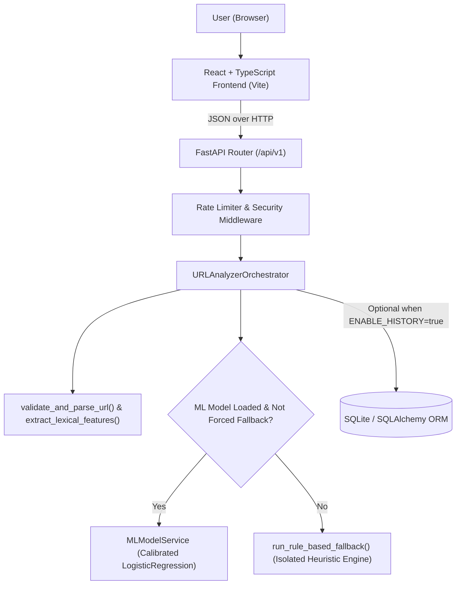

# System Design Document

**Project**: Suspicious Website / Malicious URL Detection System  
**Developer**: Anil Biradar  
**Version**: 1.0.0  

---

## 1. High-Level Architecture

The system follows a clean, layered architecture separating presentation, HTTP routing, orchestration, lexical feature extraction, machine-learning inference, rule-based fallback, and persistence:

## 2. Core Modules

### 2.1 Lexical URL Parser & Feature Extractor (`backend/app/features/url_extractor.py`)
- Operates strictly in memory using Python's `urllib.parse.urlsplit`, `ipaddress`, and `idna`.
- Validates scheme (`http` or `https`), length ($\le 2048$), character set, port validity, and label structure.
- Extracts 18 numerical features (`FEATURE_SCHEMA_VERSION = "1.0.0"`):
  1. `url_length` (`int`)
  2. `hostname_length` (`int`)
  3. `path_length` (`int`)
  4. `query_length` (`int`)
  5. `dot_count` (`int`)
  6. `hyphen_count` (`int`)
  7. `hostname_hyphen_count` (`int`)
  8. `digit_count` (`int`)
  9. `hostname_digit_count` (`int`)
  10. `query_param_count` (`int`)
  11. `subdomain_count` (`int`)
  12. `is_ip_address` (`int`: 0 or 1)
  13. `has_at_symbol` (`int`: 0 or 1)
  14. `is_https` (`int`: 0 or 1)
  15. `has_punycode` (`int`: 0 or 1)
  16. `percent_encoding_count` (`int`)
  17. `suspicious_keyword_count` (`int`)
  18. `hostname_entropy` (`float`)

### 2.2 ML Inference Service (`backend/app/ml/inference.py`)
- Loads `backend/app/ml/artefacts/url_model_v1.joblib`.
- Verifies that `feature_schema_version == "1.0.0"` and `feature_names` match the exact 18-feature list before allowing predictions.
- Uses `CalibratedClassifierCV(StandardScaler + LogisticRegression)` to output calibrated probabilities and computes standardized linear feature contributions to explain which features elevated the risk score.

### 2.3 Isolated Rule-Based Fallback Engine (`backend/app/services/fallback_analyzer.py`)
- Completely decoupled from `MLModelService`.
- Triggered when no model is loaded or when `force_fallback: true` is passed.
- Returns `analysis_method = "rule_based_fallback"`, `is_fallback = true`, and `calibrated_score = null`.

### 2.4 Frontend Architecture (`frontend/src/`)
- Single-page React 18 + TypeScript application styled with a deep navy cybersecurity theme (`frontend/src/styles/app.css`).
- Four dedicated views (`DashboardPage`, `HistoryPage`, `ModelStatusPage`, `AboutPage`) wrapped by a persistent `Navbar` and `Footer` (`Developed by Anil Biradar`).
